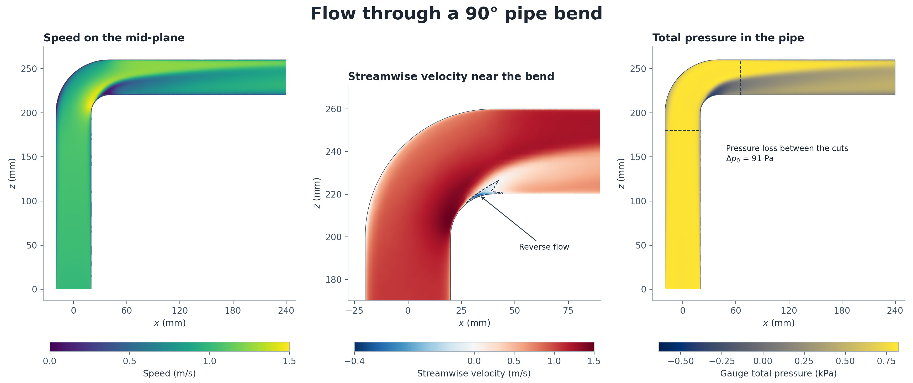

# Tutorial 4 — Meshing and simulating a 90° pipe bend

Build a 3D mesh around a 90° bend and use OpenFOAM v2606 to calculate steady, incompressible water flow. The pipe has a 40 mm internal diameter, a 40 mm centreline bend radius, and 200 mm straight legs. Flow enters along `+z` and leaves along `+x`.

## Generate and check the mesh

From the workshop directory, load OpenFOAM v2606 and run the meshing commands.

```bash
source /usr/lib/openfoam/openfoam2606/etc/bashrc
cd 04-meshing-a-pipe
surfaceCheck constant/triSurface/regionSTL.stl
blockMesh
surfaceFeatureExtract
snappyHexMesh -overwrite
checkMesh -constant -allTopology -allGeometry -meshQuality
```

The STL is in metres and contains three named regions, `inlet`, `outlet`, and `wall`. `blockMesh` creates a Cartesian background grid with 2.5 mm cells. `surfaceFeatureExtract` extracts the circular rims of the two openings. `snappyHexMesh` keeps the cells inside the pipe, snaps the boundary to the STL, and adds three layers on `wall`. In the reference run, `checkMesh` validated 61,681 cells, with all three layers on every wall face.

## Solve the flow

`simpleFoam` uses the steady RANS `kOmegaSST` model with a water kinematic viscosity of 1 × 10⁻⁶ m²/s. A mean inlet speed of 1 m/s gives a diameter-based Reynolds number of 40,000. The inlet turbulence intensity is 5%, set through `k`, and the wall uses `nutUSpaldingWallFunction`.

| Patch | Velocity `U` | Kinematic pressure `p` |
| --- | --- | --- |
| `inlet` | Fixed at `(0 0 1)` m/s | `zeroGradient` |
| `outlet` | `zeroGradient` | Fixed at 0 m²/s² |
| `wall` | `noSlip` | `zeroGradient` |

Run `simpleFoam` after meshing. To run the meshing and solver steps together after loading OpenFOAM, use `./Allrun` from the case directory. For this steady case, the time directories correspond to SIMPLE iterations. The reference run converged after 363 iterations.

## Inspect the mesh, velocity and recirculation

Open `paraFoam -builtin`. In ParaView, select `internalMesh`, click **Apply**, and select the final iteration.

1. Apply **Slice** through `y = 0` with normal `(0, 1, 0)`. Select **Surface With Edges** to inspect the wall layers. Colour the slice by `U → Magnitude` to follow the high-speed core around the bend and towards the outer side of the outlet leg.
2. To identify reversed flow, inspect the `x` component of `U` on the same slice in the outlet leg (`x > 0.04 m`). Values `Ux < 0` mark flow towards the bend. Focus on the inner wall just downstream of the bend.
3. To see the secondary circulation, make a second slice at `x = 0.065 m` with normal `(1, 0, 0)`. Apply **Calculator** with `U_Y*jHat + U_Z*kHat`, then **Glyph** with the calculated vector as the orientation. View the section along the `x` axis.

The reference solution reaches 1.51 m/s, with a minimum `Ux` of −0.35 m/s in the outlet leg near the inner wall.

## Measure pressure loss

The solver writes `pTotal` in Pa using `pTotal = ρ (p + |U|²/2)` with water density `ρ = 1000 kg/m³`. Colour the longitudinal slice by `pTotal` to inspect where the loss occurs. The monitors record the upstream value minus the downstream value at each iteration.

| Monitor under `postProcessing/` | Measurement | Reference result |
| --- | --- | --- |
| `bendPressureLoss/0/multiFieldValue.dat` | Flux-weighted total pressure loss from `z = 0.18 m` to `x = 0.065 m`. These planes bracket the bend and include short portions of both straight legs. | 91.1 Pa |
| `totalPressureLoss/0/multiFieldValue.dat` | Flux-weighted total pressure loss from the inlet to the outlet, including both straight legs. | 269.3 Pa |
| `staticPressureDrop/0/multiFieldValue.dat` | Area-averaged static pressure difference from inlet to outlet in m²/s². Multiply by 1000 kg/m³ for Pa. | 0.300 m²/s², or 300.0 Pa |

The final data row in each file gives the result at the last iteration.



## Source and licence

The geometry and meshing setup are based on Tobias Holzmann's *Meshing a Pipe* (v2112, 90° case). The original STL and SALOME geometry script are included. The workshop adaptation dated 22 November 2026 replaces the UNV background mesh with `blockMesh`, adjusts the meshing and layer settings, and adds the flow case and measurements. This tutorial is distributed under the GNU General Public License version 3. [Original training case](https://holzmann-cfd.de/community/training-cases/meshing-a-pipe) · [Licence text](COPYING)
